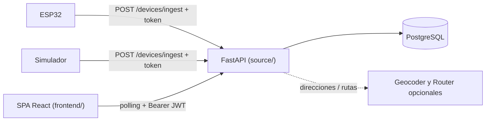

# 🚚 IterTrack - GPS Tracking System

Plataforma de rastreo y telemetría satelital GPS para flotas de camiones en tiempo real. Backend en **FastAPI** con **PostgreSQL** (SQLAlchemy 2.0 + Alembic), panel web en **React 19 + TypeScript + Vite**, simulador de flota y firmware para **ESP32**.

[](https://github.com/octa-afk/IterTrack/actions/workflows/ci.yml)

---

## 📑 Tabla de Contenidos

1. [Características](#-características)
2. [Arquitectura](#-arquitectura)
3. [Estructura del Proyecto](#-estructura-del-proyecto)
4. [Instalación](#️-instalación)
5. [Ejecución y pruebas](#️-ejecución-y-pruebas)
6. [Simulación de telemetría](#-simulación-de-telemetría)
7. [Hardware (ESP32)](#-hardware-esp32)
8. [API, roles y seguridad](#-api-roles-y-seguridad)
9. [Demo pública y despliegue](#-demo-pública-y-despliegue)
10. [Documentación relacionada](#-documentación-relacionada)

---

## 🚀 Características

* **Panel en vivo:** mapa **Leaflet + MapLibre** (mosaicos de OpenFreeMap) con el marcador de cada camión rotado según su rumbo y el recorrido del último tramo continuo.
* **Secciones:** `Panel` (mapa), `Camiones` (tabla de flota) y `Rutas` (viajes y destinos). `Reportes` y `Ajustes` figuran como próximas. Hay vistas propias para móvil.
* **Viajes tercerizados:** dador de carga, camión, chofer y paradas con coordenada. El mapa dibuja la ruta por calles hasta la próxima parada y el viaje avanza solo con la telemetría.
* **Ingesta por dispositivo:** cada equipo tiene su propio token (hash SHA-256, visible una sola vez) y emite por `POST /devices/ingest`. No hay forma de inyectar posiciones con una cuenta humana.
* **Alertas de ingesta:** los puntos rechazados se agrupan por equipo y tipo de problema, con su evidencia.
* **Multi-organización:** roles `platform_admin`, `org_admin` y `member`. Ningún listado cruza organizaciones y un recurso ajeno responde `404`.
* **Autenticación:** OAuth2 + JWT con contraseñas hasheadas con bcrypt. El registro exige un código de invitación.

---

## 🏗 Arquitectura



El flujo completo, las decisiones y el detalle de cada capa están en [`docs/ARCHITECTURE.md`](./docs/ARCHITECTURE.md).

---

## 📂 Estructura del Proyecto

```text
IterTrack/
├── source/            # Backend FastAPI: models/, schemas/, services/, database/
├── frontend/          # SPA React 19 + TypeScript + Vite (se compila a frontend/dist)
├── alembic/           # Migraciones
├── scripts/           # Simulador, bootstrap, seed de demo y circuitos de Córdoba
├── tests/             # Suite pytest (SQLite en memoria)
├── deploy/            # .env.example del despliegue (cuentas de la demo)
├── Dockerfile         # Multi-stage: Node compila la SPA, Python corre la app
├── docker-compose.yml # caddy, web, worker y postgres
├── Caddyfile          # TLS
├── docs/              # ARCHITECTURE, DEPLOYMENT y DESIGN
├── odd/tasks/         # Decisiones de diseño por feature
├── AGENTS.md          # Reglas para agentes de IA
└── ROADMAP.md         # Visión de producto
```

---

## ⚙️ Instalación

**Requisitos:** Python 3.12+, PostgreSQL, Node.js 22+ y Git.

```bash
git clone git@github.com:octa-afk/IterTrack.git
cd IterTrack
python3 -m venv env
source env/bin/activate
pip install -r requirements.txt
cp .env.example .env              # completá DATABASE_URL y SECRET_KEY
cp alembic.ini.example alembic.ini
alembic upgrade head
make frontend                     # compila frontend/dist
```

> `SECRET_KEY` debe tener **al menos 32 caracteres** (la app no arranca con una más corta). Generá una con `python -c "import secrets; print(secrets.token_urlsafe(32))"` y no la subas a Git. `.env` y `alembic.ini` están en `.gitignore`.

Una base recién migrada no tiene usuarios y el registro exige un código de invitación. Para salir de ese círculo, creá la cuenta dueña de la plataforma y, opcionalmente, la demo (ambos comandos son idempotentes y leen credenciales del entorno, ver `.env.example`):

```bash
env/bin/python -m scripts.bootstrap_platform
env/bin/python -m scripts.seed_demo
```

---

## ▶️ Ejecución y pruebas

```bash
uvicorn source.main:app --reload --port 8000
```

* Login: <http://127.0.0.1:8000/> · Panel: <http://127.0.0.1:8000/map>
* Swagger UI: <http://127.0.0.1:8000/docs> · ReDoc: <http://127.0.0.1:8000/redoc>

Sin `frontend/dist`, las rutas de la SPA responden `503`.

**Frontend con recarga en caliente:** con la API en `:8000`, corré `npm run dev` dentro de `frontend/` (<http://localhost:5173>). Vite proxya la API a `:8000`.

**Pruebas (lo mismo que corre el CI):**

```bash
make frontend && make check && make test   # build + ruff/mypy + pytest
npm --prefix frontend run lint             # oxlint
```

Los tests no necesitan PostgreSQL. Los de SPA y CSS se saltean si falta `frontend/dist`.

---

## 🛰 Simulación de telemetría

El simulador emite **solo** por `POST /devices/ingest`, igual que un ESP32. Cada camión recorre su propio circuito urbano real de Córdoba (georreferenciado con OSRM, datos de OpenStreetMap bajo ODbL) y, si hay un viaje abierto, conduce la geometría de su ruta.

```bash
make demo         # migra, siembra la demo, levanta la API y simula; Ctrl+C corta
make simulation   # solo el simulador, contra una API ya levantada
make demo SIMULATION_COUNT=5 SIMULATION_INTERVAL=1
```

Las credenciales salen de `ADMIN_API_USER` y `ADMIN_API_PASSWORD` en el `.env` raíz (o `scripts/.env`). Sin ellas el simulador aborta con código 1.

* Aprovisiona un dispositivo `SIM-<id>` por camión y **saltea** los camiones ocupados por hardware real; `--force` lo revoca.
* Al arrancar borra el historial de sus propios camiones; `--keep-history` lo conserva.
* Si no hay viaje abierto, reabre el último terminado para que el mapa tenga ruta.

---

## 🔌 Hardware (ESP32)

El firmware vive en la rama `IterTrack-Hardware`, directorio `Iter-Hard/` (PlatformIO, framework Arduino, placa `esp32dev`). Lee el GPS por serial (NMEA) y envía lotes JSON a `/devices/ingest`.

```bash
git checkout IterTrack-Hardware
```

---

## 📡 API, roles y seguridad

La referencia completa e interactiva de endpoints es **Swagger** en `/docs`. Los grupos principales:

| Grupo | Endpoints | Quién |
|---|---|---|
| Auth | `/auth/register`, `/auth/login`, `/auth/me` | Público / Bearer |
| Camiones | `/trucks`, `/trucks/{id}/location`, `/trucks/{id}/iter` | Bearer (alta: `org_admin`) |
| Dispositivos | `/devices` (alta, reasignar, rotar token, revocar) | admin |
| Ingesta | `POST /devices/ingest` | Token de dispositivo |
| Viajes | `/chargers`, `/depots`, `/trips`, `/trips/{id}/route`, `/destinations/pending` | Bearer (escritura: `org_admin`) |
| Alertas | `/alerts`, `/alerts/{id}/close` | Bearer (cerrar: `org_admin`) |
| Organizaciones | `/organizations`, `/organizations/{id}/invitation` | admin |

**Autenticación en la API:** `POST /auth/login` con `username` y `password` como *form-data* devuelve un JWT; se envía como `Authorization: Bearer <token>` (expira según `ACCESS_TOKEN_EXPIRE_MINUTES`, 60 por defecto). `POST /auth/register` exige un `invitation_code` activo; uno revocado o vencido responde `400`.

**Roles** (reforzados por un `CHECK CONSTRAINT` en la base):

| Rol | Alcance | Puede |
|---|---|---|
| `platform_admin` | Toda la plataforma | Crear organizaciones, operar en cualquiera y leer todas las flotas |
| `org_admin` | Una organización | Camiones, dispositivos, viajes e invitaciones de la suya |
| `member` | Una organización | Solo lectura: mapa e historial |

**Seguridad:**
* Login y registro tienen límite de intentos (5 fallos por usuario por minuto, 20 por IP y 10 registros por hora), en memoria y pensado para un solo proceso de uvicorn.
* Nunca se versionan secretos. Las contraseñas se guardan con bcrypt y `UserResponse` nunca expone el hash.
* Las coordenadas se validan en los esquemas Pydantic (`-90 ≤ lat ≤ 90`, `-180 ≤ long ≤ 180`).
* El CI (`.github/workflows/ci.yml`) corre en cada push y PR sobre `main` y `develop`.

---

## 🎬 Demo pública y despliegue

La demo corre en un host aislado con su propia base. El login tiene un botón **«Entrar a la demo»** que aparece solo si el servidor tiene `DEMO_MODE=true`; las credenciales las entrega `GET /config`, no el bundle.

| Cuenta | Rol | Para qué |
|---|---|---|
| `demo` | `member` | Solo lectura; es la cuenta con la que entra el botón |
| `demo-admin` | `org_admin` de `Demo Corp` | Seed y operación; **no es pública** |

La contraseña de `demo` es pública por diseño ([`deploy/.env.example`](./deploy/.env.example)). Las de `demo-admin` y `platform_admin` nunca salen del servidor: con el admin público, cualquiera podía borrar el historial o desactivar camiones. Los datos se resetean cada 24 h y un cron cada 15 min reinicia los viajes terminados.

El despliegue usa la imagen publicada en **GHCR** con Docker Compose (Caddy para TLS, `web`, `worker` y Postgres sin puertos publicados). El runbook completo está en [`docs/DEPLOYMENT.md`](./docs/DEPLOYMENT.md).

---

## 📚 Documentación relacionada

* [`docs/ARCHITECTURE.md`](./docs/ARCHITECTURE.md): arquitectura y flujo de datos.
* [`docs/DEPLOYMENT.md`](./docs/DEPLOYMENT.md): despliegue y operación.
* [`docs/DESIGN.md`](./docs/DESIGN.md): reglas visuales.
* [`odd/tasks/`](./odd/tasks): decisiones de diseño por feature (por ejemplo `destinations.md` e `ingest-alerts.md`).
* [`ROADMAP.md`](./ROADMAP.md): visión de producto.
* [`AGENTS.md`](./AGENTS.md): reglas para agentes de IA.
