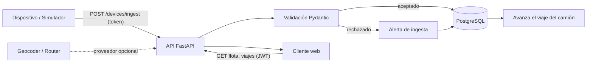
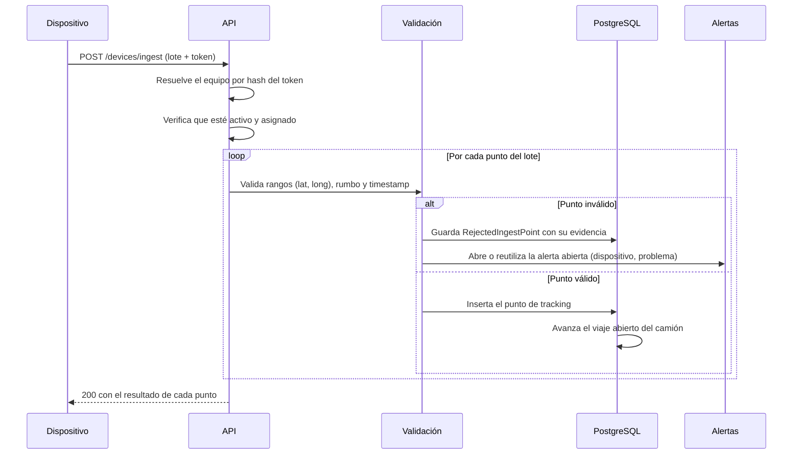
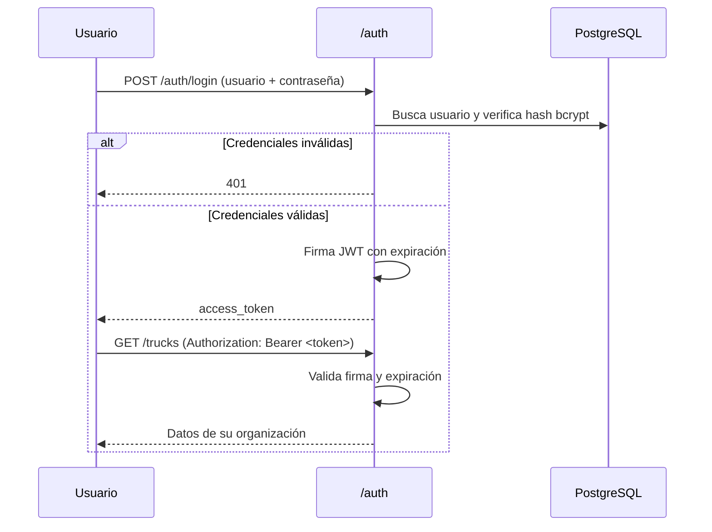
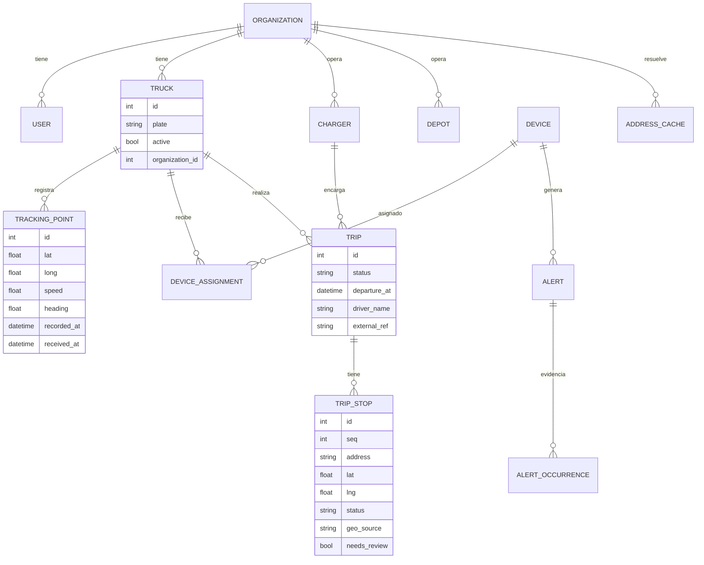

# Arquitectura — IterTrack

Documento técnico del sistema. Explica cómo se compone, cómo fluye un dato desde el vehículo hasta la pantalla y por qué las decisiones están tomadas así.

---

## 1. Visión general

IterTrack es una API REST que centraliza telemetría de vehículos, administra los envíos tercerizados que esos vehículos reparten y lo expone a un cliente web. Tiene cinco responsabilidades:

1. **Recibir** lecturas GPS autenticadas por dispositivo.
2. **Persistir** cada lectura con su historial y auditar lo que se rechaza.
3. **Exponer** el estado actual, el recorrido y el progreso de cada vehículo.
4. **Planificar** viajes con paradas y resolver direcciones a coordenadas.
5. **Aislar** los datos de cada organización cliente.

## 2. Componentes

| Componente | Responsabilidad |
|---|---|
| **Router de tracking** | Alta de vehículo, activación, transferencia entre organizaciones, consulta de ubicación y de historial. |
| **Router de ingesta de dispositivos** | `POST /devices/ingest` (lote de puntos con token de equipo) y la administración del ciclo de vida del dispositivo. |
| **Router de alertas** | Lectura de alertas abiertas y cierre manual. Agrupa los rechazos de ingesta. |
| **Router de autenticación** | Registro con código de invitación, login (OAuth2 password flow), emisión y verificación de JWT. |
| **Router de organizaciones** | Alta de organizaciones e invitaciones rotables. Alcance de `platform_admin` / `org_admin`. |
| **Router de destinos y viajes** | Dadores de carga, depósitos, viajes, paradas, resolución manual de destinos y ruta por calles. |
| **Progreso de viaje** | Módulo de dominio que traduce cada punto de telemetría en avance de paradas. No es un router. |
| **Geocoder** | Dirección → coordenada, detrás de una interfaz inyectable. |
| **Router de ruteo** | Geometría por calles entre dos puntos, detrás de una interfaz inyectable. |
| **Capa de esquemas (Pydantic)** | Validación de entrada y serialización de salida. Es el límite de confianza del sistema. |
| **Capa de modelos (SQLAlchemy 2.0)** | Persistencia tipada. Sin lógica HTTP dentro del modelo. |
| **Capa de configuración** | Variables de entorno tipadas (conexión, secreto JWT, proveedores, modo demo). |
| **Panel web (SPA)** | Aplicación React 19 + TypeScript + Vite compilada a `frontend/dist` y servida por FastAPI. Mapa con Leaflet y MapLibre. Consume la API con Bearer JWT. |

La separación es deliberada: un endpoint no construye SQL y un modelo no sabe que existe HTTP. Eso permite cambiar la capa de persistencia o el cliente sin tocar la lógica de negocio. Los dos proveedores externos (geocodificación y ruteo) están detrás de interfaces por la misma razón: el dominio de viajes no sabe si detrás hay Nominatim, OSRM o nada.

## 3. Flujo de ingesta

El hardware **no usa credenciales humanas**. Cada dispositivo se aprovisiona asignado a un camión y recibe un token que se muestra una sola vez; la base guarda únicamente su hash SHA-256. El único camino de escritura de telemetría es `POST /devices/ingest` con `Authorization: Bearer <token de dispositivo>`.

El contrato está versionado: `DeviceIngestBatch.v` es `1` por defecto para mantener compatibilidad con emisores existentes y solo acepta el valor `1`; una versión desconocida se rechaza con `422`. Cada `recorded_at` debe incluir zona horaria y se normaliza a UTC. El rumbo acepta `360` como representación equivalente al norte y lo normaliza a `0`.

**El lote es parcial, no atómico.** Cada punto se valida por separado y la respuesta trae un resultado por `sequence` con su estado, su motivo y si fue una repetición. Un punto inválido no descarta los válidos del mismo lote: perder lecturas buenas por una mala sería peor que el problema que la validación intenta evitar. El `batch_id` permite reenviar y detectar repeticiones sin duplicar el rechazo.

**Por qué validar en el borde:** el origen de los datos es un dispositivo en la calle. Puede mandar coordenadas imposibles, rumbo negativo o un timestamp del futuro. Si eso entra a la base, el mapa y cualquier estadística posterior quedan contaminados. La validación de rangos vive en el esquema, no en el endpoint, para que sea imposible saltearla.

**Por qué auditar lo rechazado.** Un punto descartado en silencio es un camión que desaparece del mapa y nadie sabe por qué. Cada rechazo queda persistido con su payload y su motivo, y se agrupa en una **alerta** por `(dispositivo, tipo de problema)`: un equipo mal aprovisionado rechaza en cada lote, y una alerta con veinte ocurrencias dice más que veinte alertas sueltas. Si la alerta se cierra y el problema vuelve, la nueva queda enlazada con la anterior, así se distingue una reincidencia de un problema nuevo. La organización se copia del dispositivo, de modo que una alerta de "sin asignación" también queda acotada al tenant.

## 4. Autenticación y autorización

El sistema tiene **dos credenciales distintas, con ciclos de vida distintos**: JWT de usuario para humanos y token opaco por dispositivo para hardware. Mezclarlas significaría que un equipo en la calle puede emitir un token de administrador, o que rotar el token de un camión invalida sesiones de personas.

### 4.1 Usuarios

OAuth2 password flow con JWT firmado en HS256.

Decisiones asociadas:

- **JWT en lugar de sesión en servidor.** La API sirve tanto a clientes web como a dispositivos; un token stateless evita estado compartido y simplifica el escalado horizontal.
- **Contraseñas con bcrypt.** Nunca se persiste ni se loguea la contraseña en claro.
- **El hash nunca sale del backend.** Los endpoints responden con un esquema de salida que no incluye el campo de contraseña.
- **Todas las operaciones requieren token.** No hay endpoints de lectura abiertos: la flota de un cliente no es información pública.
- **El registro no crea organizaciones.** Exige un `invitation_code` de una organización con invitación activa; un código revocado o vencido responde `400`.
- **El alcance del rol es explícito, no inferido del nombre.** `User.role` solo admite `platform_admin`, `org_admin` o `member`, con un `CHECK CONSTRAINT` que lo impone en la base. Tres dependencias nombran el alcance exigido (`require_platform_admin`, `require_org_admin`, `require_org_admin_or_platform`), así ningún endpoint nuevo hereda un "admin" ambiguo.

### 4.2 Dispositivos

- El token en claro existe una sola vez, en la respuesta que lo crea o lo rota. Rotarlo invalida el anterior **al instante** porque la verificación compara hashes, no un estado en memoria.
- Revocar un equipo lo desactiva y cierra su asignación abierta, liberando el camión.
- Dos índices únicos parciales garantizan **una sola asignación abierta por equipo y por camión**. Sin eso, un doble clic en la consola deja dos equipos reportando al mismo vehículo y el historial se vuelve ininterpretable.

## 5. Aislamiento entre organizaciones

Cada vehículo, dispositivo, alerta, viaje y dador de carga pertenece a una organización, y cada usuario pertenece a una. El filtrado no se delega al cliente:

- Los listados se construyen filtrando por la organización del usuario autenticado.
- Las operaciones sobre un recurso existente verifican pertenencia **antes** de actuar; un ID válido de otra organización se responde `404`, no `403`, para no revelar que existe.
- Un camión nuevo se asigna a la organización del usuario que lo crea. El alta en nombre de otra empresa es una ruta distinta (`POST /organizations/{id}/trucks`), exclusiva de `platform_admin`.
- `Device.organization_id` se toma del camión al aprovisionar, para no recorrer asignaciones en cada lectura. Cuando un camión cambia de organización, sus dispositivos con asignación abierta se mueven con él: sin eso, el tenant anterior conservaba un equipo que ya no le pertenecía.
- Las alertas copian la organización del dispositivo. Una alerta generada por un equipo sin asignación sigue acotada en vez de volverse global.
- El `platform_admin` es el único rol que puede leer datos de todas las organizaciones.

La regla es simple: *el cliente nunca elige qué organización consulta; el token ya lo determina, y el rol determina hasta dónde llega.*

## 6. Modelo de datos (conceptual)

Cada punto guarda dos marcas de tiempo: cuándo se midió y cuándo se recibió. Separarlas permite detectar lecturas que llegaron tarde o fuera de orden, algo inevitable en un dispositivo que pierde señal.

## 7. Viajes y destinos

Un **dador de carga** (`charger`) es la empresa que terceriza el envío. Es una dimensión de la organización, no un inquilino: no tiene login ni invitaciones.

Un **viaje** (`trip`) une dador, fecha de salida, camión y chofer. El chofer va en el viaje y no en el camión porque en tercerización el mismo vehículo rota de conductor según el envío. `departure_at` es una fecha con hora y zona: "salir a las 07:30" no entra en un `date`, y sin zona la salida se corre tres horas. `external_ref` es idempotente por organización: un envío reenviado responde `409` en lugar de duplicarse.

### 7.1 Direcciones y coordenadas

**La coordenada es la fuente de verdad; la dirección es texto para mostrar.** Una dirección se resuelve una sola vez y se guarda en `address_cache` con clave normalizada (sin acentos, minúsculas, espacios colapsados): "Av. Colón 1234" y "AV COLON 1234" tienen que pegarle a la misma fila, o la caché se llena de duplicados y cada importación vuelve a consultar al proveedor.

Lo que el geocoder no encuentra queda con `needs_review=true` y aparece en `GET /destinations/pending`. **No se inventa un centroide**: un pin equivocado manda al chofer al lugar incorrecto, y eso es peor que una dirección pendiente. El pin manual (`PATCH /trips/{id}/stops/{stop_id}`) resuelve el destino y escribe la caché dejando registrado qué usuario lo hizo.

### 7.2 Ruta por calles

`GET /trips/{id}/route` devuelve la geometría, la distancia y la duración del tramo hasta **la próxima parada** del viaje. Arranca en la última posición medida del camión (o en el depósito si nunca reportó) y apunta a la primera parada `pending` con coordenada, en orden de `seq`. El viaje es secuencial: no se dibuja el atajo a una parada posterior, porque mostrar ese atajo haría creer que se salteó una entrega.

Los códigos de error son parte del contrato: `409` si no hay origen o no quedan paradas ubicadas, `503` si el proveedor no está configurado, `502` si el proveedor falló. Sin proveedor, el mapa dibuja una recta punteada; nunca se inventa geometría.

### 7.3 Progreso automático

Cada punto aceptado por la ingesta mueve el viaje abierto del camión, **siempre en orden**. Sólo se evalúa la primera parada `pending`/`arrived`, así pasar cerca de la tercera antes de llegar a la primera no marca nada.

| Evento | Efecto |
|---|---|
| Entra al radio del depósito (`depots.radius_m`) | Viaje `planned` → `in_progress` |
| Entra a 120 m de la parada | Parada `pending` → `arrived` |
| Sale de esos 120 m | Parada `arrived` → `delivered` |
| Todas las paradas `delivered` | Viaje `in_progress` → `done` |

Los 120 m no son arbitrarios: un destino es una dirección, no un punto, y ese radio cubre la vereda de enfrente, el error del GPS y que el camión estacione en la esquina. Una parada sin coordenada se saltea y mantiene el viaje abierto: darla por entregada sería inventar la entrega. La transacción es del llamador; el módulo de progreso no hace `commit`.

La **elegibilidad** de un camión no usa el radio del depósito: está disponible si está activo y no tiene viaje en `planned` o `in_progress`.

## 8. Decisiones y tradeoffs

**De vanilla a SPA React.** El cliente empezó como HTML y JS sin build tooling. Se migró a React 19 + TypeScript + Vite cuando se cumplieron los criterios definidos de antemano: rutas propias con varias vistas y estado compartido entre ellas (sesión, flota, selección y telemetría). La decisión siguió siendo funcional, no estética: hoy el costo de build se paga porque el panel tiene estado propio que mantener.

La SPA no se commitea compilada. Vite genera `frontend/dist` con assets hasheados, FastAPI los sirve (`/assets`) y devuelve `index.html` en las cinco rutas para que React Router resuelva el resto. Si el build falta, esas rutas responden `503` en lugar de fallar con un traceback: el error queda accionable. Por eso el pipeline de CI compila el frontend antes de correr los tests, y cualquier despliegue debe hacer lo mismo.

**Proveedores externos detrás de una interfaz.** Geocoder y ruteo se inyectan con `Depends(get_geocoder)` y `Depends(get_router)`. Los tests los sobrescriben y nunca salen a la red. El costo de esta indirección es una capa más; el beneficio es que el dominio no depende de la política de uso de un servicio público y cambiarlo no toca ni un endpoint.

**La caché de direcciones no es una optimización, es un requisito.** La política de Nominatim limita a 1 request por segundo y 4 por minuto para scripts periódicos. Sin caché, importar la cartera de un dador de carga no termina nunca; por eso el proveedor se autolimita y la caché se escribe también desde el pin manual.

**Simulador como herramienta de primera clase.** No es un script de descarte: reproduce el comportamiento real del hardware, emite por el mismo endpoint que un ESP32 y se usa como reemplazo cuando el dispositivo no está disponible. Sin él, el sistema sólo se probaba con datos inventados.

**Validación estricta en el borde.** Un dato inválido que entra a la base es mucho más caro de corregir que uno rechazado en la puerta. Un rechazo además genera evidencia, no ruido.

**Migraciones versionadas.** El esquema se cambia con Alembic, nunca a mano. Cada migración tiene su `upgrade` y su `downgrade` revisados.

**Endpoint de salud.** `GET /health` devuelve `{"status": "ok"}` sin autenticación para permitir comprobaciones de disponibilidad sin exponer datos de la flota.

**Configuración pública mínima.** `GET /config` solo expone la cuenta de demostración cuando `DEMO_MODE` está encendido, y publica la cuenta `member` de lectura. Las credenciales del administrador de la demo nunca salen del servidor; con el flag apagado no sale ni el nombre de usuario.

**Índices de telemetría.** Los historiales se indexan por camión, momento de medición e identificador, y la ingesta conserva un índice equivalente. El orden descendente de las consultas se expresa en el índice; esto prioriza el acceso al último punto sin cambiar el modelo ni la deduplicación existente.

## 9. Alcance de este documento

El repositorio contiene el backend completo (`source/`), las migraciones (`alembic/`), los tests (`tests/`) y el panel web (`frontend/`); este documento describe su arquitectura. El firmware del dispositivo vive en la rama `IterTrack-Hardware` y no forma parte de la API. La hoja de ruta del producto está en `ROADMAP.md` y el runbook operativo en `docs/DEPLOYMENT.md`.

Las decisiones con más detalle y su historial quedan registrados en `odd/tasks/`, un archivo por unidad de trabajo.
