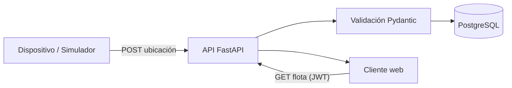
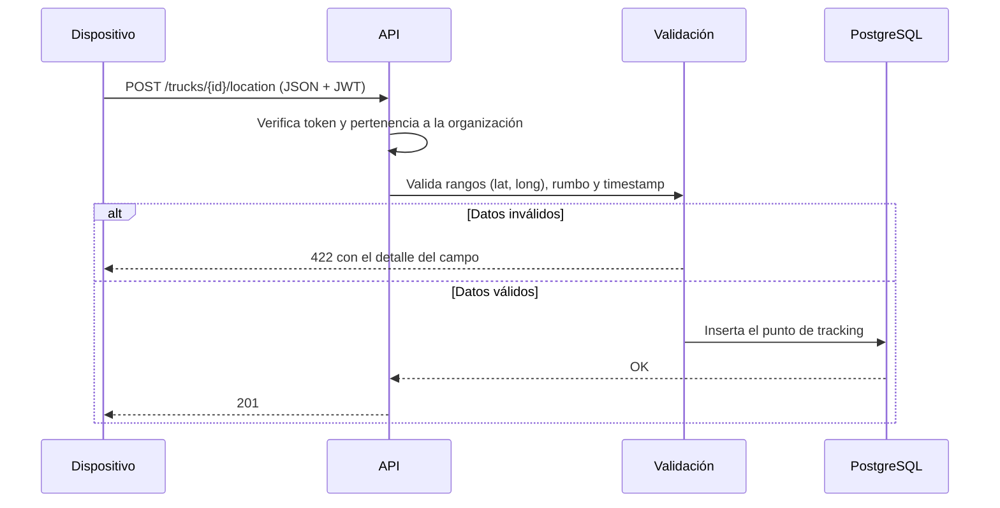
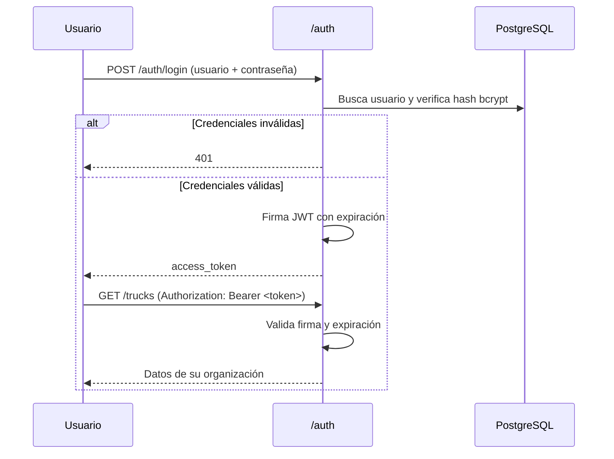
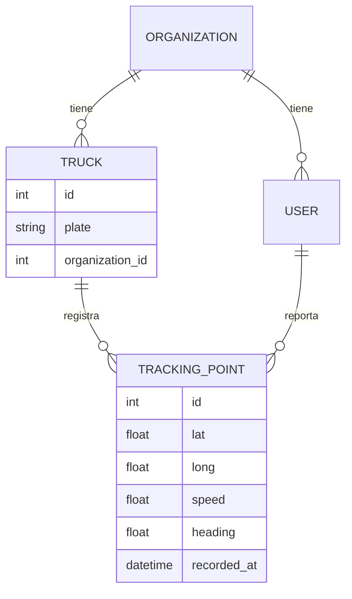

# Arquitectura — IterTrack

Documento técnico del sistema. Explica cómo se compone, cómo fluye un dato desde el vehículo hasta la pantalla y por qué las decisiones están tomadas así.

---

## 1. Visión general

IterTrack es una API REST que centraliza telemetría de vehículos y la expone a un cliente web. Tiene cuatro responsabilidades:

1. **Recibir** lecturas GPS autenticadas.
2. **Persistir** cada lectura con su historial.
3. **Exponer** el estado actual y el recorrido de cada vehículo.
4. **Aislar** los datos de cada organización cliente.

## 2. Componentes

| Componente | Responsabilidad |
|---|---|
| **Router de tracking** | Endpoints de alta de vehículo, actualización y consulta de ubicación, historial y listado. |
| **Router de autenticación** | Registro, login (OAuth2 password flow), emisión y verificación de JWT. |
| **Capa de esquemas (Pydantic)** | Validación de entrada y serialización de salida. Es el límite de confianza del sistema. |
| **Capa de modelos (SQLAlchemy 2.0)** | Persistencia tipada. Sin lógica HTTP dentro del modelo. |
| **Capa de configuración** | Variables de entorno tipadas (conexión, secreto JWT, expiración de token). |
| **Panel web (SPA)** | Aplicación React 19 + TypeScript + Vite compilada a `frontend/dist` y servida por FastAPI. Mapa con Leaflet y MapLibre. Consume la API con Bearer JWT. |

La separación es deliberada: un endpoint no construye SQL y un modelo no sabe que existe HTTP. Eso permite cambiar la capa de persistencia o el cliente sin tocar la lógica de negocio.

## 3. Flujo de ingesta

El contrato de ingesta de dispositivos está versionado explícitamente: `DeviceIngestBatch.v` es `1` por defecto para mantener compatibilidad con emisores existentes y solo acepta el valor `1`; una versión desconocida se rechaza con `422`. Cada `recorded_at` debe incluir zona horaria y se normaliza a UTC. El rumbo acepta `360` como representación equivalente al norte y lo normaliza a `0`.

**Por qué validar en el borde:** el origen de los datos es un dispositivo en la calle. Puede mandar coordenadas imposibles, rumbo negativo o un timestamp del futuro. Si eso entra a la base, el mapa y cualquier estadística posterior quedan contaminados. La validación de rangos vive en el esquema, no en el endpoint, para que sea imposible saltearla.

## 4. Autenticación y autorización

El sistema usa **OAuth2 password flow con JWT firmado en HS256**.

Decisiones asociadas:

- **JWT en lugar de sesión en servidor.** La API sirve tanto a clientes web como a dispositivos; un token stateless evita estado compartido y simplifica el escalado horizontal.
- **Contraseñas con bcrypt.** Nunca se persiste ni se loguea la contraseña en claro.
- **El hash nunca sale del backend.** Los endpoints responden con un esquema de salida que no incluye el campo de contraseña.
- **Todas las operaciones requieren token.** No hay endpoints de lectura abiertos: la flota de un cliente no es información pública.

## 5. Aislamiento entre organizaciones

Cada vehículo pertenece a una organización, y cada usuario pertenece a una. El filtrado no se delega al cliente:

- Los listados se construyen filtrando por la organización del usuario autenticado.
- Las operaciones sobre un vehículo existente verifican pertenencia **antes** de actuar; un ID válido de otra organización se trata como no encontrado.
- Un vehículo nuevo se asigna automáticamente a la organización del usuario que lo crea.

La regla es simple: *el cliente nunca elige qué organización consulta; el token ya lo determina.*

## 6. Modelo de datos (conceptual)

Cada punto guarda dos marcas de tiempo: cuándo se midió y cuándo se recibió. Separarlas permite detectar lecturas que llegaron tarde o fuera de orden, algo inevitable en un dispositivo que pierde señal.

## 7. Decisiones y tradeoffs

**De vanilla a SPA React.** El cliente empezó como HTML y JS sin build tooling. Se migró a React 19 + TypeScript + Vite cuando se cumplieron los criterios definidos de antemano: rutas propias con varias vistas (`/`, `/register`, `/map`) y estado compartido entre ellas (sesión, flota, selección y telemetría). La decisión siguió siendo funcional, no estética: hoy el costo de build se paga porque el panel tiene estado propio que mantener.

La SPA no se commitea compilada. Vite genera `frontend/dist` con assets hasheados, FastAPI los sirve (`/assets`) y devuelve `index.html` en las tres rutas para que React Router resuelva el resto. Si el build falta, esas rutas responden `503` en lugar de fallar con un traceback: el error queda accionable. Por eso el pipeline de CI compila el frontend antes de correr los tests, y cualquier despliegue debe hacer lo mismo.

**Simulador como herramienta de primera clase.** No es un script de descarte: reproduce el comportamiento real del hardware y se usa como reemplazo cuando el dispositivo no está disponible. Sin él, el sistema sólo se probaba con datos inventados.

**Validación estricta en el borde.** Un dato inválido que entra a la base es mucho más caro de corregir que uno rechazado en la puerta.

**Migraciones versionadas.** El esquema se cambia con Alembic, nunca a mano. Cada migración tiene su `upgrade` y su `downgrade` revisados.

**Endpoint de salud.** `GET /health` devuelve `{"status": "ok"}` sin autenticación para permitir comprobaciones de disponibilidad sin exponer datos de la flota.

**Índices de telemetría.** Los historiales se indexan por camión, momento de medición e identificador, y la ingesta conserva un índice equivalente. El orden descendente de las consultas se expresa en el índice; esto prioriza el acceso al último punto sin cambiar el modelo ni la deduplicación existente.

## 8. Alcance de este documento

Este repositorio público documenta la arquitectura y publica el simulador. El código del backend, el esquema completo de la base y la hoja de ruta del producto son privados por tratarse de un desarrollo comercial.
