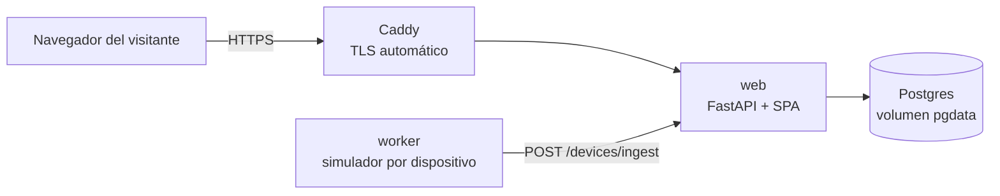

# Despliegue — IterTrack

Runbook operativo de la demo pública. Decisiones tomadas el 2026-10-23; el historial completo está en [`odd/tasks/demo-deployment.md`](../odd/tasks/demo-deployment.md).

## 1. Qué se despliega

Una demo **aislada**: su propio host, su propia base, y credenciales públicas que no dan acceso a ningún dato de un cliente real.



Cuatro servicios en un solo host (`docker-compose.yml`):

| Servicio | Qué hace | Regla |
|---|---|---|
| `caddy` | TLS y reverse proxy | Único que publica puertos (80/443) |
| `web` | FastAPI + SPA | Único que corre migraciones |
| `worker` | Flota simulada de la demo | `RUN_MIGRATIONS=false` |
| `postgres` | Base de datos | **Sin puertos publicados** |

## 2. Dónde se hostea

**Azure for Students**, una VM `Standard_B2ats_v2` en **`chilecentral`**, con Docker Compose.

> **Dos restricciones reales de la suscripción de estudiante, verificadas el 2026-10-23.** No son evidentes en el portal y cuestan una hora de diagnóstico:
>
> 1. **Política de regiones.** La suscripción trae asignada la política `sys.regionrestriction` (*Allowed resource deployment regions*) con una lista cerrada: `chilecentral`, `southafricanorth`, `newzealandnorth`, `canadacentral` y `northcentralus`. Desplegar en `brazilsouth` o `eastus2` falla con `RequestDisallowedByAzure`, un error que la CLI de Azure reporta como un `RuntimeError` sin cuerpo.
> 2. **`B1s` no está disponible para esta oferta.** El catálogo lo marca `NotAvailableForSubscription` en las diez regiones consultadas, incluidas las permitidas por la política. `Standard_B2ats_v2` (2 vCPU, 1 GB, x64) **sí** está disponible en `chilecentral` y también entra en las 750 h gratuitas.
>
> Consulta rápida antes de elegir región y tamaño:
>
> ```bash
> az policy assignment list --query "[].{name:name, params:parameters}" -o json
> az vm list-skus -l chilecentral --size Standard_B2ats_v2 --resource-type virtualMachines -o table
> ```

Motivos:

- **750 h/mes gratis durante 12 meses** de VM `B1s` / `B2pts v2` / `B2ats v2`, más USD 100 de crédito, **sin tarjeta de crédito**, renovable mientras siga siendo estudiante. De los tres, en la práctica solo `B2ats_v2` está disponible en las regiones permitidas.
- **Chile Central está más cerca de Córdoba que Brazil South**, así que la restricción de política no empeora la latencia: la mejora.
- **AWS queda descartado**: su free tier 2026 da hasta USD 200, pero la cuenta **se cierra sola a los 6 meses**, así que no sirve para una demo permanente.
- La alternativa sin administrar servidor es **Heroku** (USD 13/mes durante 24 meses con el Student Pack), pero no permite un worker separado para el simulador.

## 3. Reglas de portabilidad

El objetivo es poder mudarse de host en una hora. Para eso:

| Decisión | Por qué |
|---|---|
| Imagen en **GHCR**, no en un registry del proveedor | Cualquier host puede hacer `docker pull` |
| Dominio en **Namecheap**, no en Azure DNS | Mudarse = cambiar el registro A |
| **Postgres en Docker** con volumen nombrado | No hay que migrar desde un servicio administrado |
| Nada de Azure Blob, Entra ID ni ingress propio | La app no conoce al proveedor |
| Todo por variables de entorno | No hay configuración compilada por host |

Lo único atado a Azure es la VM que alquila. Cuando vencen los 12 meses, se levanta el mismo `compose` en otro lado.

## 4. Prerrequisitos

1. Cuenta de **Azure for Students** activa (con email institucional).
2. Un **dominio** apuntando a la VM (registro `A`). El `.me` gratuito de Namecheap del Student Pack alcanza.
3. La imagen publicada en GHCR por el workflow `publish-image.yml`. Publica un tag por rama al pushear a `main` o `develop`: mientras la demo corra desde `develop`, el tag es `:develop`. **Verificar que el run esté en verde antes de desplegar**: `docker manifest inspect` devuelve `unauthorized` tanto si el paquete es privado como si el tag no existe.
4. Acceso SSH a la VM.
5. Un **Personal Access Token** de GitHub con scope `read:packages`, si el paquete de GHCR es privado.

> **El repositorio es privado** (verificado contra la API de GitHub: responde `404` sin autenticación). El paquete de GHCR hereda esa visibilidad, así que la VM debe autenticarse antes de hacer `pull`. Dos caminos:
>
> - **Recomendado:** PAT con `read:packages` y `docker login ghcr.io` en la VM.
> - Alternativa: poner el paquete como público en *Package settings → Change visibility*. Si GitHub lo permite para un repo privado, evita el token; comprobalo en la UI antes de contar con eso.
>
> El token del PAT **no** va al repositorio ni al `docker-compose.yml`: se guarda en `~/.docker/config.json` de la VM.

## 5. Primer despliegue

La VM **no necesita clonar el repositorio**: le bastan tres archivos (`docker-compose.yml`, `Caddyfile` y `.env`) y permiso para hacer `pull` de la imagen. Eso mantiene el host desacoplado del código y evita guardar credenciales de Git ahí.

```bash
# En la VM
sudo apt update && sudo apt install -y docker.io docker-compose-v2
sudo usermod -aG docker "$USER"   # cerrar sesión y volver a entrar

mkdir -p ~/itertrack && cd ~/itertrack

# Autenticación contra GHCR (solo si el paquete es privado)
echo "<PAT con read:packages>" | docker login ghcr.io -u octa-afk --password-stdin
```

```bash
# Desde tu máquina, en el repo
scp docker-compose.yml Caddyfile deploy/.env.example octa@57.156.58.24:~/itertrack/
```

```bash
# En la VM
cd ~/itertrack
mv .env.example .env
# completar DOMAIN, POSTGRES_PASSWORD, SECRET_KEY,
# PLATFORM_ADMIN_PASSWORD, DEMO_*_PASSWORD

# La ruta por calles hasta la próxima parada: sin esto el mapa cae al
# respaldo (recta punteada). La instancia pública de OSRM es solo para la demo:
# ROUTING_PROVIDER=osrm
# ROUTING_URL=https://router.project-osrm.org

# La base tiene que ser accesible desde el host del compose:
# DATABASE_URL=postgresql+psycopg2://itertrack:<pass>@postgres:5432/itertrack_db

docker compose up -d
docker compose ps
docker compose logs -f web
```

En el primer arranque el entrypoint, en este orden: `alembic upgrade head` → bootstrap de plataforma → seed de demo. Todo es idempotente, así que reiniciar no duplica nada.

## 6. Verificación

```bash
curl -fsS https://TU_DOMINIO/health          # {"status":"ok"}
curl -fsS https://TU_DOMINIO/ | head -5      # index.html de la SPA

# Login de la demo
curl -fsS -X POST https://TU_DOMINIO/auth/login \
  -d "username=demo-admin" -d "password=<DEMO_ADMIN_PASSWORD>"
```

En el navegador: `/` muestra el login, `/map` el panel, y los camiones de `Demo Corp` se mueven cada 2 segundos.

Checklist mínimo:

- [ ] `GET /health` responde 200.
- [ ] La SPA carga y el botón **Entrar a la demo** aparece y entra al mapa.
- [ ] `GET /config` devuelve `{"demo":{"enabled":true,...}}` con la cuenta de **solo lectura** (`DEMO_USERNAME`), nunca `demo-admin`.
- [ ] `GET /alerts` responde `401` sin token (el router está registrado) y `200 []` con la cuenta de la demo. Con un equipo mal aprovisionado aparece una alerta abierta.
- [ ] El registro con el código de la demo responde `400`: la invitación nace revocada.
- [ ] El mapa muestra 3 camiones moviéndose.
- [ ] En Rutas, un viaje pasa solo de **Planificado** a **En curso** y sus paradas se van marcando: el estado lo mueve el camión al pasar cerca (120 m), no el operador.
- [ ] `demo-admin` recibe 403 al intentar crear una organización.
- [ ] El owner de plataforma (no público) ve `IterTrack` y `Demo Corp`.

## 7. Operación

**Entrar a la VM**

```bash
ssh -i ~/.ssh/id_ed25519 octa@57.156.58.24
```

**Ver logs**

```bash
docker compose logs -f web
docker compose logs -f worker
tail -f /home/octa/renew.log    # reposición de viajes de la demo (cada 15 min)
tail -f /home/octa/reset.log    # reset diario del tenant de demo
```

**¿Está viva la demo?** El worker puede parecer sano (`Up`) y no estar ingiriendo nada: el estado real es si entran puntos.

```bash
# En la VM: los últimos puntos y su antigüedad por camión
docker compose exec -T web python - <<'PY'
from datetime import UTC, datetime, timedelta
from source.database.database import SessionLocal
from source.models.ingestion import IngestedPoint
from source.models.truck import TrackingPoint

db = SessionLocal()
now = datetime.now(UTC)
print("ingeridos últimos 10 min:",
      db.query(IngestedPoint).filter(IngestedPoint.received_at >= now - timedelta(minutes=10)).count())
for tid in (1, 2, 3):
    last = db.query(TrackingPoint).filter(TrackingPoint.truck_id == tid).order_by(TrackingPoint.id.desc()).first()
    print(tid, last and f"hace {(now - last.received_at).total_seconds():.0f} s")
db.close()
PY
```

**Reiniciar el worker borra el recorrido de sus camiones.** Desde que cada corrida
arranca limpia, el worker borra el historial de los camiones que simula antes del
primer punto (nunca el de un camión con hardware real). Es lo esperado: los
trazados del mapa empiezan de cero después de un `restart`.

Si el worker muestra `Ingesta rechazada (401): {"detail":"Invalid device credentials"}` y `No se pudieron listar dispositivos (401)` a la vez, perdió el token del dispositivo **y** la credencial para recuperarlo: reiniciar `docker compose restart worker` lo devuelve al ruedo. Las imágenes con el fix de re-autenticación se recuperan solas.

**Rebarrer la demo** (borra y recrea solo el tenant de demo; no toca la cuenta de plataforma)

```bash
docker compose exec web python -m scripts.seed_demo --reset
```

Para automatizarlo, un cron del host cada 24 h con el mismo comando. Es necesario: el admin de la demo es público y puede borrar los datos.

La VM tiene dos cron instalados, los dos con `/usr/bin/docker` absoluto (cron no
hereda el PATH interactivo) y el log en el home, que sobrevive a un reinicio:

```cron
0 4 * * *  cd /home/octa/itertrack && /usr/bin/docker compose exec -T web python -m scripts.seed_demo --reset >> /home/octa/reset.log 2>&1
*/15 * * * * cd /home/octa/itertrack && /usr/bin/docker compose exec -T web python -m scripts.seed_demo --renew >> /home/octa/renew.log 2>&1
```

El `cd` no es opcional: `docker compose` busca el compose en el directorio actual
y cron arranca en `$HOME`.

**Mantener la demo con viajes en curso** (cron cada 15 min)

El progreso automático cierra los viajes de la demo en unos 11 minutos de
simulación: las tres paradas están en el mismo circuito que el camión recorre
completo. Este comando **reinicia el mismo viaje** (`DEMO-001/002/003`) de cada
camión que terminó —vuelve a `planned` con las paradas pendientes— y no toca nada
más del tenant. No crea filas nuevas: con un cron cada 15 minutos, clonar dejaría
cientos de viajes por día en la lista de Rutas:

```bash
docker compose exec -T web python -m scripts.seed_demo --renew
```

```cron
*/15 * * * * cd /home/octa/itertrack && /usr/bin/docker compose exec -T web python -m scripts.seed_demo --renew >> /home/octa/renew.log 2>&1
```

Para comprobar que cron lo ejecuta de verdad —y no sólo que el comando funciona a
mano— se puede dejar un minuto en `* * * * *`, esperar a que aparezca la línea en
el log y volver a `*/15`.

> El reset borra los dispositivos del tenant. En imágenes viejas, el worker se queda con tokens inválidos y sin forma de renovarlos: después del reset hay que hacer `docker compose restart worker`. Con el fix de re-autenticación ya no hace falta.
>
> **El cron corre con la hora del host, que está en UTC**: `0 4 * * *` son las 01:00 de Argentina. Si la demo se va a mostrar de madrugada, conviene moverlo.

**Actualizar la imagen**

```bash
docker compose pull && docker compose up -d
```

> La VM tiene su **propia copia** de `docker-compose.yml`, no la del repo. Si un cambio toca el comando del `worker` o las variables del compose, hay que volver a copiarlo antes de recrear:
>
> ```bash
> # desde tu máquina, en el repo
> scp docker-compose.yml octa@57.156.58.24:~/itertrack/
> ```
>
> Ejemplo real: al retirar el modo usuario del simulador, el `worker` dejó de aceptar `--mode device` y un `pull` sin actualizar el compose lo deja en `unrecognized arguments`.

**Backup y restore** (los datos viven en el volumen `pgdata`)

```bash
docker compose exec -T postgres pg_dump -Fc -U itertrack itertrack_db > backup.dump
docker compose exec -T postgres pg_restore -d itertrack_db -U itertrack --clean < backup.dump
```

**Mirar la base desde tu máquina** (sin exponer el puerto)

```bash
ssh -L 5433:localhost:5432 -i ~/.ssh/id_ed25519 octa@57.156.58.24
# DATABASE_URL=postgresql+psycopg2://itertrack:<pass>@localhost:5433/itertrack_db
```

> La VM actual es la `itertrack-vm` de Azure (IP `57.156.58.24`, usuario `octa`, clave `~/.ssh/id_ed25519`). Ese `-i` es necesario: no hay entrada en `~/.ssh/config`.

> Nunca corras migraciones desde tu máquina contra la base de la VM. Migra solo el contenedor `web`.

## 8. Rollback

```bash
docker compose down          # conserva pgdata, caddy_data y caddy_config
IMAGE=ghcr.io/octa-afk/itertrack:sha-<commit> docker compose up -d
```

`docker compose down -v` **borra los volúmenes**, incluida la base. No usarlo salvo que quieras empezar de cero.

## 9. Mudarse a otro host

1. `docker compose down` en el host viejo.
2. Copiar `docker-compose.yml`, `Caddyfile`, `.env` y el dump de la base.
3. `docker compose up -d` en el host nuevo.
4. Restaurar el dump.
5. Cambiar el registro `A` del dominio al IP nuevo.

## 10. Costos y vencimiento

| Concepto | Costo |
|---|---|
| VM `B1s` (12 meses, 750 h/mes) | USD 0 |
| Dominio `.me` (Namecheap, 1 año) | USD 0 |
| GHCR (imagen pública) | USD 0 |
| **Total año 1** | **USD 0** |

Al vencer los 12 meses: renovar la suscripción de estudiante, o mover el mismo `compose` a un VPS de ~USD 5/mes.

**Límite real:** la VM tiene 1 GB de RAM. Alcanza para los cuatro servicios (~500 MB) pero no para construir la imagen, por eso el build ocurre en GitHub Actions y la VM solo hace `pull`.

## 11. Qué nunca va al repositorio

| Variable | Pública |
|---|---|
| `DEMO_MODE` | ✅ Sí, es `true` en la demo y `false` en un cliente |
| `DEMO_ADMIN_USERNAME`, `DEMO_ADMIN_PASSWORD` | ✅ Sí, el login los pide a `GET /config` |
| `DEMO_MEMBER_PASSWORD` | ✅ Sí, está en el ejemplo |
| `PLATFORM_ADMIN_PASSWORD` | ❌ Nunca |
| `SECRET_KEY` | ❌ Nunca |
| `POSTGRES_PASSWORD` | ❌ Nunca |
