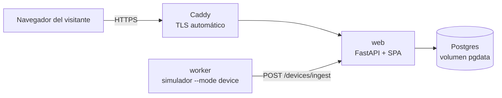

# Despliegue — IterTrack

Runbook operativo de la demo pública. Decisiones tomadas el 2026-10-23; el historial completo está en [`odd/tasks/demo-deployment.md`](../odd/tasks/demo-deployment.md).

## 1. Qué se despliega

Una demo **aislada**: su propio host, su propia base, y credenciales públicas que no dan acceso a ningún dato de un cliente real.



Cuatro servicios en un solo host (`docker-compose.yml`):

| Servicio | Qué hace | Regla |
|---|---|---|
| `caddy` | TLS y reverse proxy | Único que publica puertos (80/443) |
| `web` | FastAPI + SPA | Único que corre migraciones |
| `worker` | Flota simulada de la demo | `RUN_MIGRATIONS=false` |
| `postgres` | Base de datos | **Sin puertos publicados** |

## 2. Dónde se hostea

**Azure for Students**, una VM `B1s`, con Docker Compose.

Motivos:

- **750 h/mes gratis durante 12 meses** de VM `B1s` / `B2pts v2` / `B2ats v2`, más USD 100 de crédito, **sin tarjeta de crédito**, renovable mientras siga siendo estudiante.
- **AWS queda descartado**: su free tier 2026 da hasta USD 200, pero la cuenta **se cierra sola a los 6 meses**, así que no sirve para una demo permanente.
- La alternativa sin administrar servidor es **Heroku** (USD 13/mes durante 24 meses con el Student Pack), pero no permite un worker separado para el simulador.

## 3. Reglas de portabilidad

El objetivo es poder mudarse de host en una hora. Para eso:

| Decisión | Por qué |
|---|---|
| Imagen en **GHCR**, no en un registry del proveedor | Cualquier host puede hacer `docker pull` |
| Dominio en **Namecheap**, no en Azure DNS | Mudarse = cambiar el registro A |
| **Postgres en Docker** con volumen nombrado | No hay que migrar desde un servicio administrado |
| Nada de Azure Blob, Entra ID ni ingress propio | La app no conoce al proveedor |
| Todo por variables de entorno | No hay configuración compilada por host |

Lo único atado a Azure es la VM que alquila. Cuando vencen los 12 meses, se levanta el mismo `compose` en otro lado.

## 4. Prerrequisitos

1. Cuenta de **Azure for Students** activa (con email institucional).
2. Un **dominio** apuntando a la VM (registro `A`). El `.me` gratuito de Namecheap del Student Pack alcanza.
3. La imagen publicada en GHCR por el workflow `publish-image.yml` (se dispara al pushear a `main`).
4. Acceso SSH a la VM.

> El repositorio es **público**, así que el paquete de GHCR debe ser público o la VM necesita autenticarse contra `ghcr.io`.

## 5. Primer despliegue

```bash
# En la VM
sudo apt update && sudo apt install -y docker.io docker-compose-v2
sudo usermod -aG docker "$USER"   # cerrar sesión y volver a entrar

git clone https://github.com/octa-afk/IterTrack.git
cd IterTrack
git checkout main

cp deploy/.env.example .env
# completar DOMAIN, POSTGRES_PASSWORD, SECRET_KEY,
# PLATFORM_ADMIN_PASSWORD, DEMO_*_PASSWORD

# La base tiene que ser accesible desde el host del compose:
# DATABASE_URL=postgresql+psycopg2://itertrack:<pass>@postgres:5432/itertrack_db

docker compose up -d
docker compose ps
docker compose logs -f web
```

En el primer arranque el entrypoint, en este orden: `alembic upgrade head` → bootstrap de plataforma → seed de demo. Todo es idempotente, así que reiniciar no duplica nada.

## 6. Verificación

```bash
curl -fsS https://TU_DOMINIO/health          # {"status":"ok"}
curl -fsS https://TU_DOMINIO/ | head -5      # index.html de la SPA

# Login de la demo
curl -fsS -X POST https://TU_DOMINIO/auth/login \
  -d "username=demo-admin" -d "password=<DEMO_ADMIN_PASSWORD>"
```

En el navegador: `/` muestra el login, `/map` el panel, y los camiones de `Demo Corp` se mueven cada 2 segundos.

Checklist mínimo:

- [ ] `GET /health` responde 200.
- [ ] La SPA carga y el login de demo funciona.
- [ ] El mapa muestra 3 camiones moviéndose.
- [ ] `demo-admin` recibe 403 al intentar crear una organización.
- [ ] El owner de plataforma (no público) ve `IterTrack` y `Demo Corp`.

## 7. Operación

**Ver logs**

```bash
docker compose logs -f web
docker compose logs -f worker
```

**Rebarrer la demo** (borra y recrea solo el tenant de demo; no toca la cuenta de plataforma)

```bash
docker compose exec web python -m scripts.seed_demo --reset
```

Para automatizarlo, un cron del host cada 24 h con el mismo comando. Es necesario: el admin de la demo es público y puede borrar los datos.

**Actualizar la imagen**

```bash
docker compose pull && docker compose up -d
```

**Backup y restore** (los datos viven en el volumen `pgdata`)

```bash
docker compose exec -T postgres pg_dump -Fc -U itertrack itertrack_db > backup.dump
docker compose exec -T postgres pg_restore -d itertrack_db -U itertrack --clean < backup.dump
```

**Mirar la base desde tu máquina** (sin exponer el puerto)

```bash
ssh -L 5433:localhost:5432 usuario@IP_DE_LA_VM
# DATABASE_URL=postgresql+psycopg2://itertrack:<pass>@localhost:5433/itertrack_db
```

> Nunca corras migraciones desde tu máquina contra la base de la VM. Migra solo el contenedor `web`.

## 8. Rollback

```bash
docker compose down          # conserva pgdata, caddy_data y caddy_config
IMAGE=ghcr.io/octa-afk/itertrack:sha-<commit> docker compose up -d
```

`docker compose down -v` **borra los volúmenes**, incluida la base. No usarlo salvo que quieras empezar de cero.

## 9. Mudarse a otro host

1. `docker compose down` en el host viejo.
2. Copiar `docker-compose.yml`, `Caddyfile`, `.env` y el dump de la base.
3. `docker compose up -d` en el host nuevo.
4. Restaurar el dump.
5. Cambiar el registro `A` del dominio al IP nuevo.

## 10. Costos y vencimiento

| Concepto | Costo |
|---|---|
| VM `B1s` (12 meses, 750 h/mes) | USD 0 |
| Dominio `.me` (Namecheap, 1 año) | USD 0 |
| GHCR (imagen pública) | USD 0 |
| **Total año 1** | **USD 0** |

Al vencer los 12 meses: renovar la suscripción de estudiante, o mover el mismo `compose` a un VPS de ~USD 5/mes.

**Límite real:** la VM tiene 1 GB de RAM. Alcanza para los cuatro servicios (~500 MB) pero no para construir la imagen, por eso el build ocurre en GitHub Actions y la VM solo hace `pull`.

## 11. Qué nunca va al repositorio

| Variable | Pública |
|---|---|
| `DEMO_ADMIN_PASSWORD`, `DEMO_MEMBER_PASSWORD` | ✅ Sí, se muestran en el login |
| `PLATFORM_ADMIN_PASSWORD` | ❌ Nunca |
| `SECRET_KEY` | ❌ Nunca |
| `POSTGRES_PASSWORD` | ❌ Nunca |
